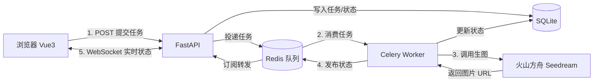

# AI 图文生成网站

> 基于 Vue3 + FastAPI + Redis + Celery + WebSocket 的 AI 文生图 / 图生图系统

## 一、项目简介

本项目是一个前后端分离的 AI 图文生成网站，对接火山方舟 Seedream 大模型，支持**文生图**与**图生图**。针对大模型生图接口耗时较长（约 20 秒）导致的 HTTP 同步超时问题，采用 **Redis + Celery 异步任务队列**实现任务异步化，并通过 **WebSocket + Redis Pub/Sub** 实时向用户推送任务进度。全程调用云端大模型 API，**无需本地 GPU**。

| 项目信息 | 说明 |
| --- | --- |
| 项目类型 | 全栈 Web 应用（实训 / 简历项目） |
| 开发角色 | 独立全栈开发 |
| 核心链路 | 提交任务 → 异步队列 → 云端生图 → 实时推送 → 画廊展示 |

## 二、技术栈

| 分类 | 技术 | 用途 |
| --- | --- | --- |
| 前端 | Vue 3 + Vite + axios | 页面渲染、接口请求、WebSocket 监听 |
| 后端 | FastAPI + Uvicorn | REST 接口、WebSocket 服务 |
| 异步任务 | Celery + Redis | 任务队列与消息总线 |
| 存储 | SQLite | 任务记录与历史数据 |
| 生图模型 | 火山方舟 Seedream（OpenAI 兼容接口） | 云端文生图 / 图生图 |

## 三、核心功能

- **文生图 / 图生图**：支持提示词生图；支持上传参考图（转 base64）进行图生图
- **参数可配置**：提示词、负面提示词、尺寸（1024×1024 / 1280×720）
- **异步生成**：提交后毫秒级返回 task_id，不阻塞接口
- **实时进度推送**：WebSocket 实时展示「排队中 → 生成中 → 成功 / 失败」
- **作品画廊**：历史记录分页展示、图片预览、右键保存下载

## 四、系统架构



**请求流程：**

1. 前端提交任务 → FastAPI 写入 SQLite（状态 `queued`）并投递到 Celery 队列
2. Celery worker 从 Redis 队列消费任务
3. worker 调用火山方舟 Seedream 生成图片（耗时约 20 秒，异步执行）
4. worker 更新 SQLite 状态，并通过 Redis Pub/Sub 发布到 `task:{task_id}` 频道
5. FastAPI 的 WebSocket 订阅该频道，将状态实时转发给浏览器

## 五、技术亮点

1. **Redis + Celery 异步任务队列**
   生图接口耗时约 20 秒，若用同步 HTTP 会长时间占用请求线程并触发前端超时。通过 Celery 将生图任务异步化，提交接口毫秒级返回 `task_id`，显著提升并发能力与用户体验。

2. **WebSocket + Redis Pub/Sub 跨进程实时推送**
   Celery worker 与 FastAPI 是独立进程，无法直接通信。利用 Redis Pub/Sub 作为消息总线：worker 发布状态到频道，FastAPI 订阅后经 WebSocket 推送给前端，实现任务状态的实时展示。

3. **OpenAI 兼容格式封装第三方大模型**
   火山方舟 Seedream 提供 OpenAI 兼容接口，使用官方 openai SDK 调用，通过 `extra_body` 透传扩展参数（`watermark`、`image` 数组），统一封装文生图与图生图。

4. **图生图 base64 传输**
   前端通过 `FileReader` 将上传图片转为 base64 data URI，封装进 `image` 数组传给模型，避免 multipart 文件上传与额外文件存储。

5. **SQLite 任务持久化 + 断线兜底**
   设计 `generations` 表记录提示词、负面提示词、尺寸、图片链接、状态、时间。前端 WebSocket 断线时可通过 REST 接口查询任务状态兜底。

6. **前后端分离 + CORS 跨域**
   Vue3 + Vite 前端通过 axios 调用 REST API，FastAPI 开启 CORS 支持开发期跨域调试。

## 六、核心难点与解决方案

| 难点 | 解决方案 |
| --- | --- |
| 生图接口耗时长，同步调用会超时 | 引入 Celery 异步任务队列，接口只负责投递，生图在 worker 异步执行 |
| worker 与 Web 服务跨进程，状态无法直接推送 | 通过 Redis Pub/Sub 桥接，worker 发布、WebSocket 订阅转发 |
| Windows 无官方 Redis、Celery 不支持默认进程池 | 使用 Redis 便携版 + Celery `--pool=solo` 运行模式 |
| Seedream 模型 ID 带日期版本会下线、无负面提示词字段 | 模型 ID 抽离为环境变量可随时更换；负面提示词拼接进主提示词近似实现 |
| 依赖版本冲突（openai 与 httpx 不兼容） | 锁定兼容版本 `httpx==0.27.2`，保证可复现 |

## 七、项目结构

```
ai-image-generator/
├── backend/
│   ├── main.py         # FastAPI：REST 接口 + WebSocket
│   ├── celery_app.py   # Celery 配置（Redis broker/backend）
│   ├── tasks.py        # 异步生图任务 + 状态推送
│   ├── ark_client.py   # Seedream 接口封装（OpenAI 兼容）
│   ├── db.py           # SQLite 数据库操作
│   └── .env.example    # 配置模板
├── frontend/
│   └── src/
│       ├── App.vue     # 主组件（状态管理 + WebSocket）
│       ├── components/ # 生成表单、作品画廊
│       └── api.js      # axios 封装
├── start.bat           # Windows 一键启动脚本
└── README.md           # 详细运行文档
```

## 八、运行方式

详见 [README.md](./README.md)。一键启动：双击 `start.bat`（自动启动 Redis、Celery、FastAPI、前端），浏览器访问 `http://localhost:5173`。

## 九、可扩展方向

- 任务队列支持多 worker 并发、任务重试与超时控制
- 图片 URL 过期后自动转存对象存储（OSS/COS），实现永久保存
- 接入用户体系与作品点赞/分享
- 接入更多模型（Seedream 5.0、视频生成 Seedance）
