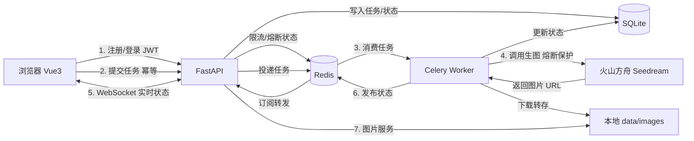

# AI 图文生成系统（生产级）

> 基于 Vue3 + FastAPI + Redis + Celery + WebSocket 的 AI 文生图 / 图生图全栈系统，具备完整的用户鉴权、限流、熔断、任务可靠性与工程化能力。

## 一、项目简介

本项目是一个前后端分离的 AI 图文生成系统，对接火山方舟 Seedream 大模型，支持**文生图**与**图生图**。针对大模型生图接口耗时较长（约 20~40 秒）导致的 HTTP 同步超时问题，采用 **Redis + Celery 异步任务队列**实现任务异步化，并通过 **WebSocket + Redis Pub/Sub** 实时推送任务进度。在此基础上，从原型版本升级为**生产可用版本**，补齐了鉴权、限流、熔断、幂等、图片本地化、可观测性等工程化能力。全程调用云端大模型 API，**无需本地 GPU**。

| 项目信息 | 说明 |
| --- | --- |
| 项目类型 | 全栈 Web 应用（生产级） |
| 开发角色 | 独立全栈开发 |
| 核心链路 | 登录鉴权 → 提交任务 → 异步队列 → 云端生图 → 实时推送 → 本地转存 → 画廊展示 |
| 并发能力 | 100 并发压测成功率 100%（36.5 req/s） |

## 二、技术栈

| 分类 | 技术 | 用途 |
| --- | --- | --- |
| 前端 | Vue 3 + Vite + axios + WebSocket | 页面渲染、接口请求、实时监听、懒加载/分页 |
| 后端 | FastAPI + Uvicorn + PyJWT | REST 接口、WebSocket 服务、JWT 鉴权 |
| 异步任务 | Celery + Redis | 任务队列、消息总线、限流/熔断状态存储 |
| 存储 | SQLite | 用户与任务数据、本地图片文件 |
| 生图模型 | 火山方舟 Seedream（OpenAI 兼容接口） | 云端文生图 / 图生图 |
| 测试 | Locust + 冒烟/端到端测试脚本 | 并发压测与链路验证 |

## 三、核心功能

- **文生图 / 图生图**：提示词生图；拖拽上传参考图（格式/大小/文件头三重校验）
- **用户体系**：注册 / 登录，JWT 鉴权，多用户数据隔离（仅可见本人作品）
- **异步生成**：提交后毫秒级返回 task_id，不阻塞接口
- **实时进度推送**：WebSocket 实时展示「排队中 → 生成中 → 重试中 → 成功/失败」，断线自动重连 + 轮询兜底
- **图片本地转存**：解决云端 URL 24h 过期，支持一键下载与本地备份
- **作品画廊**：图片懒加载、滚动分页、大图预览、参数回看、一键下载
- **安全防护**：IP + 用户双维度限流、上传文件头校验、密钥环境变量注入 + 脱敏
- **任务可靠性**：幂等提交、worker 宕机恢复、失败自动重试（≤2 次）、熔断降级
- **可观测性**：分级日志（任务 ID 全链路追踪）、Locust 压测报告、数据备份脚本

## 四、系统架构



**请求流程：**

1. 前端注册/登录，获取 JWT，后续请求携带 `Authorization: Bearer` 令牌
2. 提交任务（携带 `request_id` 幂等键），FastAPI 校验鉴权 → 限流 → 文件安全校验 → 幂等写入 SQLite（`queued`）
3. Celery worker 从 Redis 队列消费任务
4. worker 调用火山方舟 Seedream 生成图片（受熔断器保护，超时/连续失败自动降级）
5. 生成成功后 worker 下载云端图片转存到本地 `data/images/`，更新 SQLite 并发布 Redis Pub/Sub
6. FastAPI 的 WebSocket 订阅频道，将状态实时转发给浏览器
7. 前端画廊经 `/api/image/{task_id}` 读取本地图片（带鉴权）

## 五、技术亮点

1. **Redis + Celery 异步任务队列**
   生图接口耗时 20~40 秒，若同步调用会长时间占用请求线程并触发前端超时。通过 Celery 异步化，提交接口毫秒级返回 `task_id`，压测下提交接口吞吐达 17.6 req/s（中位数 98ms），显著提升并发能力。

2. **WebSocket + Redis Pub/Sub 跨进程实时推送**
   Celery worker 与 FastAPI 是独立进程，无法直接通信。利用 Redis Pub/Sub 作为消息总线桥接：worker 发布状态、WebSocket 订阅转发，实现任务状态实时展示；前端封装 WebSocket 自动重连（指数退避）+ 轮询兜底。

3. **JWT 鉴权 + 多用户数据隔离**
   注册/登录采用 PBKDF2（20 万次迭代）加盐哈希存储密码，JWT 令牌鉴权；任务记录关联 `user_id`，查询/图片/WebSocket 接口均校验归属，实现用户级数据隔离。

4. **接口防护：双维度限流 + 文件头校验**
   基于 Redis 固定窗口计数器实现 IP + 用户双维度限流，超阈值返回 429；图生图上传校验 MIME 类型、大小上限、文件头魔数（magic bytes），防止伪装格式的恶意文件。

5. **熔断降级（Circuit Breaker）**
   实现三态熔断器（closed/open/half-open），状态存 Redis 跨 worker 共享。大模型连续失败/超时 N 次后快速失败、返回友好提示，冷却后放行试探请求，避免服务雪崩。

6. **任务可靠性：幂等 + 重试 + 宕机恢复**
   以 `request_id` 唯一键实现幂等提交，网络重试/双击不重复生成；`task_acks_late` + `visibility_timeout` 保证 worker 崩溃后任务自动重入队；失败自动重试 ≤2 次（指数退避）。

7. **图片本地转存解决 URL 过期**
   火山方舟返回的图片 URL 约 24 小时过期。worker 生成后自动下载转存到本地目录，DB 记录 `local_path`，前端经鉴权接口读取，支持一键下载与本地备份。

8. **工程化与可观测性**
   分级日志（info/error/debug）记录任务全生命周期、密钥脱敏输出；Locust 并发压测（100 并发成功率 100%）；SQLite 在线备份 + 图片目录备份脚本；Windows/Linux 一键启动脚本；依赖版本精确锁定。

## 六、核心难点与解决方案

| 难点 | 解决方案 |
| --- | --- |
| 生图接口耗时长，同步调用会超时 | 引入 Celery 异步任务队列，接口只负责投递，生图在 worker 异步执行 |
| worker 与 Web 服务跨进程，状态无法直接推送 | Redis Pub/Sub 桥接：worker 发布、WebSocket 订阅转发 |
| 网络抖动导致重复提交/重复生成 | `request_id` 幂等键 + 唯一约束，重复提交直接返回已有任务 |
| 大模型接口故障可能拖垮系统 | 三态熔断器快速失败 + 冷却后试探恢复，避免雪崩 |
| worker 异常宕机导致任务丢失 | `task_acks_late` + `visibility_timeout` 未完成任务自动重入队 |
| 图片 URL 24h 过期，历史作品失效 | worker 生成后自动下载转存本地，前端走本地图片服务 |
| 上传文件伪造格式（改后缀） | 后端校验 MIME + 文件头魔数，拦截伪装文件 |
| Windows 无官方 Redis、Celery 不支持默认进程池 | Redis 便携版 + Celery `--pool=solo` 运行模式 |
| Seedream 模型 ID 带日期版本会下线、无负面提示词字段 | 模型 ID 抽离环境变量可随时更换；负面提示词拼接进主提示词近似实现 |
| 依赖版本冲突（openai 与 httpx 不兼容） | 锁定兼容版本 `httpx==0.27.2`，全量精确锁版本保证可复现 |

## 七、性能指标

| 指标 | 数值 |
| --- | --- |
| 压测工具 / 并发 | Locust 2.32 / 100 并发 |
| 聚合吞吐 | 36.51 req/s |
| 成功率 | 100%（1632 请求 0 失败） |
| 提交任务吞吐 | 17.58 req/s（中位数 98ms） |
| 历史查询吞吐 | 10.80 req/s（中位数 53ms） |
| 真实生图耗时 | 约 44 秒（端到端实测） |

> 详见 [docs/LOAD_TEST_REPORT.md](./docs/LOAD_TEST_REPORT.md)。

## 八、项目结构

```
ai-image-generator/
├── backend/
│   ├── main.py             # FastAPI：鉴权/限流/接口/图片服务/WebSocket
│   ├── celery_app.py       # Celery 配置（可靠性/并发/超时/日志）
│   ├── tasks.py            # 异步任务：生图 + 转存 + 重试 + 熔断
│   ├── ark_client.py       # Seedream 封装（超时 + 熔断 + 脱敏）
│   ├── auth.py             # JWT 签发/校验 + PBKDF2 密码哈希
│   ├── rate_limit.py       # Redis 固定窗口限流（IP + 用户）
│   ├── circuit_breaker.py  # 三态熔断器
│   ├── security.py         # 上传文件格式/大小/文件头校验
│   ├── config.py           # 集中配置（环境变量）
│   ├── logging_config.py   # 分级日志 + 滚动文件
│   ├── db.py               # SQLite：用户表 + 任务表 + 迁移 + 幂等
│   └── backup.py           # 数据备份脚本
├── frontend/src/
│   ├── App.vue             # 主组件（登录态/状态管理/预览下载）
│   ├── api/                # request.js + auth.js + generate.js
│   ├── store/auth.js       # 登录态 composable
│   ├── ws.js               # WebSocket 封装（自动重连 + 兜底）
│   └── components/         # LoginView / GeneratorForm / ProgressBar / Gallery
├── tests/                  # locustfile.py / smoke_test.py / e2e_test.py
├── docs/                   # DEPLOY.md / ARCHITECTURE.md / LOAD_TEST_REPORT.md
├── scripts/start.sh        # Linux 一键启动
├── start.bat               # Windows 一键启动
└── README.md
```

## 九、运行方式

详见 [README.md](./README.md)。一键启动：双击 `start.bat`（Windows）或 `bash scripts/start.sh`（Linux），浏览器访问 `http://localhost:5173`，注册账号后登录使用。

## 十、可扩展方向

- SQLite 迁移至 PostgreSQL，Uvicorn 多 worker，支撑更高并发
- 图片上传对象存储（OSS/COS），实现异地容灾
- 接入更多模型（Seedream 5.0、视频生成 Seedance）
- 增加作品点赞/分享、生成历史导出等社交化功能
- 引入 CI/CD 自动化测试与部署流水线
